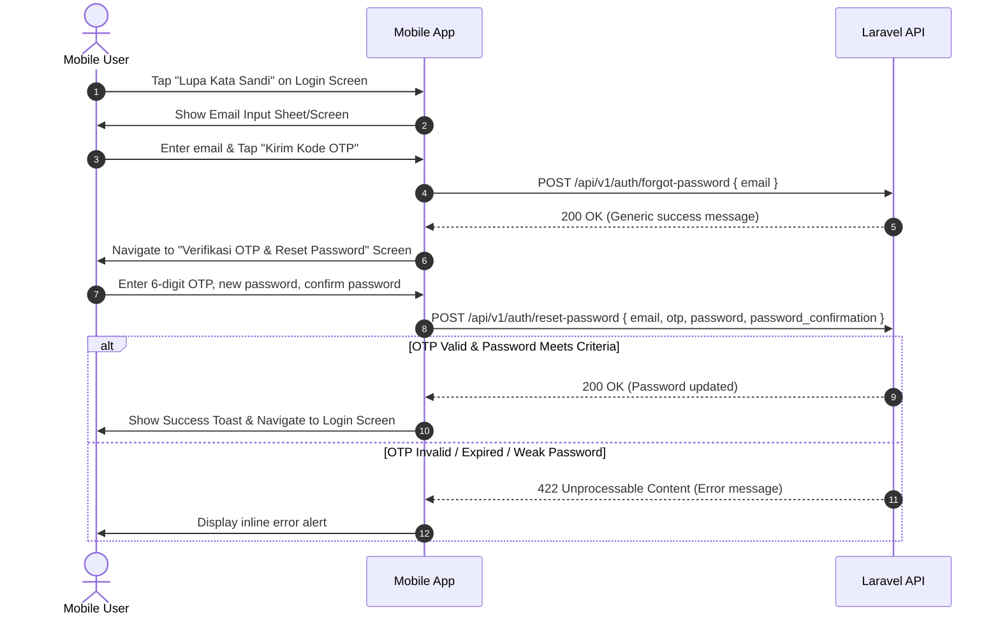

# Mobile API Specification: Forgot & Reset Password

> **Target Audience**: AI Agents (LLMs), iOS (SwiftUI), Android (Kotlin), and Frontend Engineers integrating the Forgot Password flow.

---

## 1. Overview & Architecture

* **Authentication Context**: Public (Unauthenticated).
* **Delivery Mechanism**: Hybrid (Email contains both Web Token Link & 6-digit numeric OTP).
* **Target User**: Mobile app user who forgot their password.
* **OTP Expiration**: **15 minutes** from generation.
* **OTP Format**: 6-digit numeric string (e.g., `"482910"`).

---

## 2. Base Configuration

* **Default Base URL**: `https://<your-domain>/api/v1` (or local dev: `http://localhost:8000/api/v1`)
* **Required Request Headers**:
  ```http
  Content-Type: application/json
  Accept: application/json
  ```

---

## 3. Endpoints

### 3.1. Request OTP (Forgot Password)

Initiates the reset flow by dispatching a 6-digit OTP to the user's registered email.

* **Method**: `POST`
* **Path**: `/api/v1/auth/forgot-password`
* **Rate Limit**: Max 3 attempts per 15 minutes per IP (`throttle:3,15`).
* **Security Consideration**: Protects against user enumeration. Always returns `200 OK` with a generic message even if the email does not exist.

#### Request Body
| Field | Type | Required | Description |
|---|---|---|---|
| `email` | `string` | **Yes** | Valid registered email address. |

```json
{
  "email": "employee@kiranagroup.com"
}
```

#### Success Response (`200 OK`)
```json
{
  "meta": {
    "code": 200,
    "status": "success",
    "message": "Jika email Anda terdaftar, instruksi reset kata sandi dan kode OTP telah dikirimkan ke email Anda."
  },
  "data": null
}
```

#### Error Response (`422 Unprocessable Content` - Invalid Input)
```json
{
  "message": "Format email tidak valid.",
  "errors": {
    "email": [
      "Format email tidak valid."
    ]
  }
}
```

#### Error Response (`429 Too Many Requests`)
```json
{
  "message": "Too Many Attempts."
}
```

---

### 3.2. Verify OTP & Reset Password

Validates the 6-digit OTP code and updates the user's password. Automatically revokes all active Sanctum tokens upon success.

* **Method**: `POST`
* **Path**: `/api/v1/auth/reset-password`
* **Rate Limit**: Max 5 attempts per 15 minutes per IP (`throttle:5,15`).

#### Password Complexity Rules
1. Minimum **8 characters**.
2. Must contain letters (mixed case: uppercase and lowercase).
3. Must contain numbers.
4. Must match `password_confirmation`.
5. Cannot be the default password or user's date of birth.

#### Request Body
| Field | Type | Required | Constraints |
|---|---|---|---|
| `email` | `string` | **Yes** | Must match the email requested in step 1. |
| `otp` | `string` | **Yes** | Exactly 6 numeric characters (`size:6`). |
| `password` | `string` | **Yes** | Min 8 chars, mixed case, numbers. |
| `password_confirmation` | `string` | **Yes** | Must match `password` exactly. |

```json
{
  "email": "employee@kiranagroup.com",
  "otp": "482910",
  "password": "NewSecretPassword123",
  "password_confirmation": "NewSecretPassword123"
}
```

#### Success Response (`200 OK`)
```json
{
  "meta": {
    "code": 200,
    "status": "success",
    "message": "Kata sandi Anda berhasil diperbarui. Silakan masuk menggunakan kata sandi baru."
  },
  "data": null
}
```

#### Error Response (`422 Unprocessable Content` - Invalid / Expired OTP)
```json
{
  "meta": {
    "code": 422,
    "status": "error",
    "message": "Kode OTP tidak valid atau salah."
  },
  "data": null
}
```
*(If OTP is older than 15 minutes, message will be: `"Kode OTP telah kedaluwarsa. Silakan ajukan reset kata sandi baru."`)*

#### Error Response (`422 Unprocessable Content` - Weak Password / Confirmation Mismatch)
```json
{
  "message": "Konfirmasi kata sandi tidak cocok.",
  "errors": {
    "password": [
      "Konfirmasi kata sandi tidak cocok.",
      "Kata sandi harus mengandung huruf besar dan kecil.",
      "Kata sandi baru minimal 8 karakter."
    ]
  }
}
```

---

## 4. Mobile Client UX Workflow Guide



---

## 5. Swift (iOS) Client Integration Example

```swift
import Foundation

struct ForgotPasswordRequest: Encodable {
    let email: String
}

struct ResetPasswordRequest: Encodable {
    let email: String
    let otp: String
    let password: String
    let passwordConfirmation: String

    enum CodingKeys: String, CodingKey {
        case email
        case otp
        case password
        case passwordConfirmation = "password_confirmation"
    }
}

struct ApiResponseMeta: Decodable {
    let code: Int
    let status: String
    let message: String
}

struct ApiResponse<T: Decodable>: Decodable {
    let meta: ApiResponseMeta
    let data: T?
}

final class AuthService {
    private let baseURL = URL(string: "https://your-domain.com/api/v1")!

    // Step 1: Request OTP
    func requestForgotPasswordOtp(email: String) async throws -> String {
        let url = baseURL.appendingPathComponent("auth/forgot-password")
        var request = URLRequest(url: url)
        request.httpMethod = "POST"
        request.setValue("application/json", forHTTPHeaderField: "Content-Type")
        request.setValue("application/json", forHTTPHeaderField: "Accept")
        request.httpBody = try JSONEncoder().encode(ForgotPasswordRequest(email: email))

        let (data, response) = try await URLSession.shared.data(for: request)
        guard let httpResponse = response as? HTTPURLResponse, (200...299).contains(httpResponse.statusCode) else {
            throw NSError(domain: "AuthService", code: 400, userInfo: [NSLocalizedDescriptionKey: "Gagal mengirim permintaan OTP."])
        }

        let apiResponse = try JSONDecoder().decode(ApiResponse<EmptyDecodable>.self, from: data)
        return apiResponse.meta.message
    }

    // Step 2: Reset Password with OTP
    func resetPassword(email: String, otp: String, newPassword: String) async throws -> String {
        let url = baseURL.appendingPathComponent("auth/reset-password")
        var request = URLRequest(url: url)
        request.httpMethod = "POST"
        request.setValue("application/json", forHTTPHeaderField: "Content-Type")
        request.setValue("application/json", forHTTPHeaderField: "Accept")
        
        let payload = ResetPasswordRequest(
            email: email,
            otp: otp,
            password: newPassword,
            passwordConfirmation: newPassword
        )
        request.httpBody = try JSONEncoder().encode(payload)

        let (data, response) = try await URLSession.shared.data(for: request)
        let httpResponse = response as? HTTPURLResponse

        if let httpResponse, httpResponse.statusCode == 200 {
            let apiResponse = try JSONDecoder().decode(ApiResponse<EmptyDecodable>.self, from: data)
            return apiResponse.meta.message
        } else {
            // Attempt to parse standard meta error or validation error
            if let apiError = try? JSONDecoder().decode(ApiResponse<EmptyDecodable>.self, from: data) {
                throw NSError(domain: "AuthService", code: 422, userInfo: [NSLocalizedDescriptionKey: apiError.meta.message])
            }
            throw NSError(domain: "AuthService", code: 422, userInfo: [NSLocalizedDescriptionKey: "Gagal mereset kata sandi. Periksa OTP dan format kata sandi Anda."])
        }
    }
}

struct EmptyDecodable: Decodable {}
```
