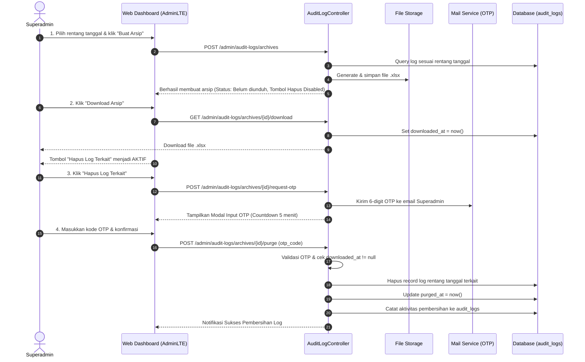

# Spesifikasi Desain: Modul Audit Log CRUD (Eksklusif Superadmin)

Dokumen ini merupakan hasil sesi perancangan (*brainstorming*) untuk implementasi pencatatan log CRUD (Create, Read, Update, Delete) di aplikasi web Kirana People, yang hanya dapat diakses oleh **Superadmin**, dilengkapi fitur ekspor `.xlsx`, serta proteksi ganda pembersihan log dengan syarat download arsip dan konfirmasi OTP.

---

## 1. Ringkasan Kebutuhan (Understanding Summary)

- **Tujuan Modul:** Menyediakan jejak audit (*audit trail*) transparan terhadap setiap perubahan data operasional dan master data di web admin, guna menjaga integritas dan akuntabilitas sistem.
- **Pengguna Target:** **Hanya Superadmin (`role:super-admin`)**. Admin biasa, HR, dan Karyawan dilarang mengakses rute maupun melihat menu ini.
- **Cakupan Model yang Dicatat:**
  - `User` (Perubahan data karyawan / profil / kredensial)
  - `Shift` (Pengaturan jam kerja / jam istirahat)
  - `Location` (Titik lokasi GPS kantor / radius absen)
  - `Attendance` (Koreksi / perubahan data presensi)
  - `Setting` (Konfigurasi sistem global)
  - `Role` & Permission (Perubahan hak akses Spatie RBAC)
- **Fitur Utama:**
  1. Halaman web riwayat log dengan paginasi, filter tanggal/event/modul/user, dan modal *diff comparison* (sebelum vs sesudah).
  2. Tombol Export langsung ke format Excel (`.xlsx`).
  3. Mekanisme Pembersihan Data (*Purge/Delete*) dengan **Dual-Gate Security**:
     - **Gate 1 (Mandatory Archive & Download):** Data harus diarsipkan ke file Excel di server dan diunduh oleh Superadmin terlebih dahulu.
     - **Gate 2 (Email OTP Confirmation):** Superadmin wajib mengonfirmasi kode OTP 6-digit yang dikirimkan ke email terdaftarnya sebelum data log fisik di database dihapus.

---

## 2. Asumsi & Non-Goals

### Asumsi
- Masa simpan log bersifat **Unlimited** (tidak ada auto-purge otomatis berbasis cron), pembersihan hanya terjadi jika dipicu secara eksplisit oleh Superadmin.
- Email OTP memanfaatkan sistem notifikasi email yang sudah ada (Resend/SMTP).
- Field sensitif seperti `password`, `remember_token`, payload `avatar_base64`, dan `selfie_base64` otomatis disaring dan diabaikan dari snapshot log agar tidak memberatkan database dan menjaga kerahasiaan.

### Non-Goals
- Tidak mencatat aksi baca/view halaman biasa (hanya mutasi data: Create, Update, Delete).
- Tidak mengizinkan penghapusan log per baris individu tanpa melalui alur arsip dan OTP (mencegah manipulasi jejak audit).

---

## 3. Decision Log (Log Keputusan)

| No | Topik Keputusan | Keputusan yang Dipilih | Alternatif yang Dipertimbangkan | Alasan Pemilihan |
|:---|:---|:---|:---|:---|
| 1 | Cakupan Model | Semua data operasional & master | Hanya data master tertentu | Memberikan visibilitas menyeluruh terhadap seluruh aktivitas penting di sistem |
| 2 | Tampilan UI | Tabel ringkas + Modal Diff | Teks log sederhana | Mempermudah peninjauan perubahan nilai atribut secara spesifik |
| 3 | Masa Simpan (Retensi) | Permanen (Unlimited) | Auto-delete 90 hari | Memenuhi kebutuhan audit jangka panjang perusahaan |
| 4 | Arsitektur Hapus & Arsip | **Opsi 2: Server Archive Registry** | Opsi 1: Sesi sementara (Stateless) | Memastikan backup file Excel tersimpan secara resmi di server sebelum penghapusan diizinkan |
| 5 | Proteksi Eksekusi Hapus | Dual-Gate: Wajib Download + OTP Email | Konfirmasi password akun biasa | Memberikan jaminan tingkat tinggi bahwa file arsip telah tersimpan dan aksi dilakukan oleh pemilik akun sah |

---

## 4. Arsitektur Teknis & Skema Database

### A. Migrasi Tabel `audit_log_archives`
Tabel untuk mencatat berkas arsip yang di-generate:

```php
Schema::create('audit_log_archives', function (Blueprint $table) {
    $table->id();
    $table->foreignId('user_id')->constrained('users')->cascadeOnDelete();
    $table->string('filename');
    $table->string('file_path');
    $table->date('date_from');
    $table->date('date_to');
    $table->unsignedInteger('total_records');
    $table->timestamp('downloaded_at')->nullable();
    $table->timestamp('purged_at')->nullable();
    $table->timestamps();
});
```

### B. Tabel Verifikasi OTP Penghapusan
Penyimpanan OTP sementara (atau via Cache/Session berbatas waktu 5 menit):
- Key: `audit_purge_otp_{user_id}_{archive_id}`
- Value: Hash kode 6 digit
- Expiry: 300 detik (5 menit)

### C. Penyempurnaan Trait `HasAuditLog`
Mengecualikan kolom sensitif saat serialisasi atribut:
```php
$ignoredFields = ['password', 'remember_token', 'avatar_base64', 'selfie_base64'];
```

---

## 5. Alur Kerja (Workflow)



---

## 6. Antarmuka Pengguna (UI Wireframe & Components)

1. **Sidebar Menu:**
   - Ditampilkan hanya dengan pengecekan: `@if(auth()->user()->isSuperAdmin())`.
   - Ikon: `bi bi-journal-text` atau `bi bi-shield-lock`.
   - Label: **Log Audit CRUD**.
2. **Tab 1: Log Aktivitas:**
   - Filter bar: Rentang Tanggal, Model/Modul, Tipe Aksi (Created, Updated, Deleted), User Pelaku.
   - Tombol Export Excel: Mengunduh langsung log sesuai filter aktif.
   - Tabel Log: Waktu, Pelaku, Modul & ID, Event, IP Address, Tombol "Lihat Detail".
   - Modal Detail: Tampilan side-by-side perbandingan kolom data (Sebelum vs Sesudah).
3. **Tab 2: Arsip & Pembersihan Data:**
   - Form pembuatan arsip rentang tanggal.
   - Tabel daftar arsip: Tanggal Dibuat, Rentang Data, Jumlah Record, Status Download, Status Pembersihan.
   - Tombol Aksi: Download Arsip, Hapus Data (dengan validasi modal OTP).

---

## 7. Rencana Pengujian (Testing Strategy)

- **Unit/Feature Test:**
  - Memastikan hanya role `super-admin` yang dapat mengakses halaman dan endpoint API audit log (role `admin`, `HR`, dan `karyawan` menerima HTTP 403).
  - Memastikan trait `HasAuditLog` otomatis mencatat mutasi data pada `User`, `Shift`, `Location`, `Attendance`, `Setting`.
  - Memastikan kolom `password` dan `base64` tidak tercatat di JSON audit log.
  - Memastikan request delete log ditolak jika file arsip belum diunduh (`downloaded_at == null`).
  - Memastikan request delete log ditolak jika kode OTP salah atau kedaluwarsa.
  - Memastikan data log berhasil terhapus setelah OTP valid dan file terunduh.
